# SCO 310 / SIT 300 — Component Programming Project Report

## QR Component Studio

**A QR Code generator built from reusable JavaBeans components**

| Submission detail | Information |
|---|---|
| Student name | `[STUDENT NAME]` |
| Registration number | `[REGISTRATION NUMBER]` |
| Lecturer | Dr. Bernard Ondara, Ph.D. |
| Institution | Kenyatta University — Department of Computing |
| Unit | SCO 310 / SIT 300 — Component Programming |
| Submission date | `[DATE]` |

---

## Table of contents

1. The application
2. Output formats
3. Main program logic
4. Components used
5. QR Code generation
6. Configuration and saved data
7. Testing
8. Problems fixed
9. Conclusion
10. References

---

## 1. The application

QR Component Studio accepts text, creates a QR Code, displays it and saves the generated file. The
same window also shows the selected output format, recent history and details about the generated
symbol.

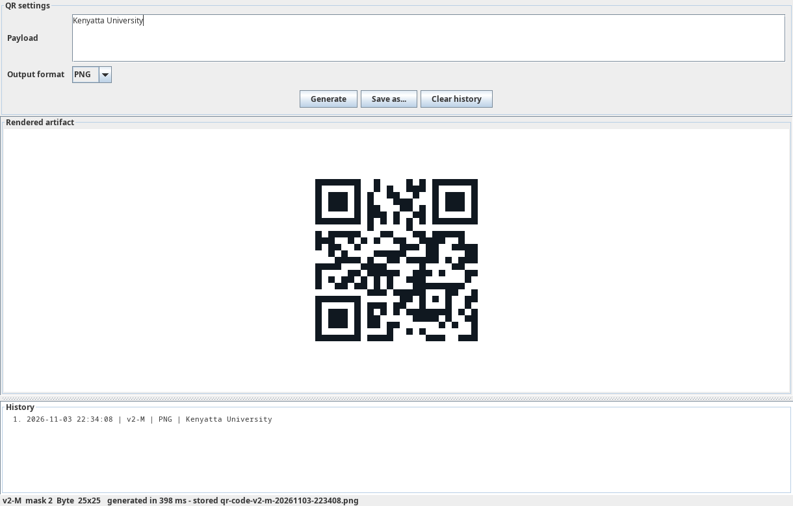

### 1.1 Entering the text and choosing the format

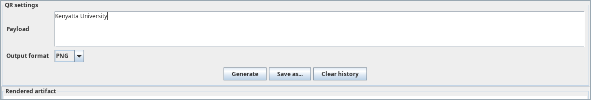

The payload box contains the text to be encoded. The output selector chooses the renderer used for
the result. When **Generate** is clicked, the text is passed to `QrStudioFacadeBean`, which starts the
generation process.

### 1.2 Result, history and saved file

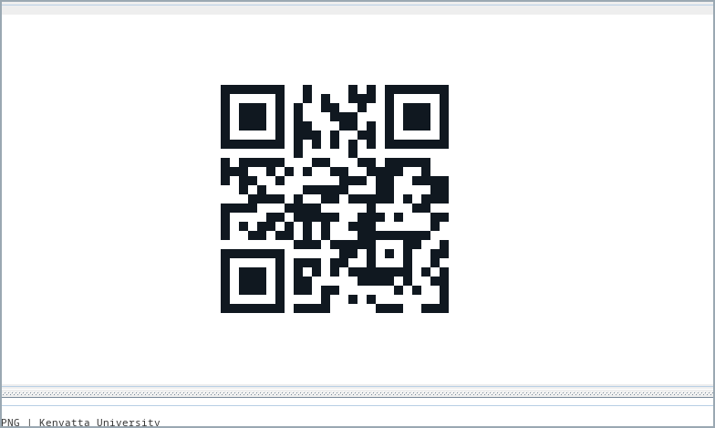

The encoder creates the QR matrix and the selected renderer turns it into the requested output. The
result is displayed in the preview area.

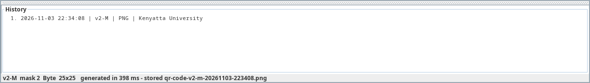

After generation, the history area records the operation. The status line shows the QR version,
error-correction level, mask, generation time and saved filename.

---

## 2. Output formats

The application uses separate renderer components. Changing the format does not change the encoder,
history or file-storage components.

### 2.1 PNG

The PNG result is shown in Section 1. It is produced by `PngRendererBean` using the configured module
size, quiet zone and colours.

### 2.2 SVG

`SvgRendererBean` creates vector output from the same QR matrix. The image remains clear when it is
resized.

### 2.3 Text

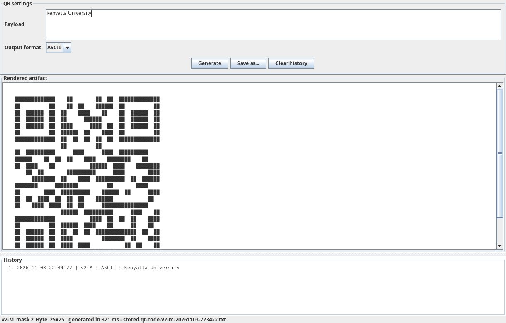

`AsciiRendererBean` changes the dark and light modules into text characters. The application shows
the result in a scrollable text area.

### 2.4 Other available formats

The project also contains `RoundedModuleRendererBean` for rounded PNG output and
`PdfRendererBean` for vector PDF output. Both implement the same `QrCodeRenderer` interface.

---

## 3. Main program logic

### 3.1 Encoder interface

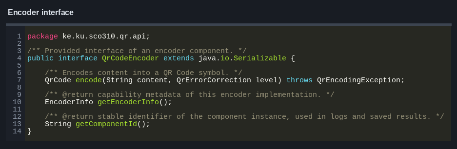

`QrCodeEncoder` defines the method used to encode text. The built-in encoder and the optional ZXing
encoder both implement this interface.

### 3.2 Encoder component

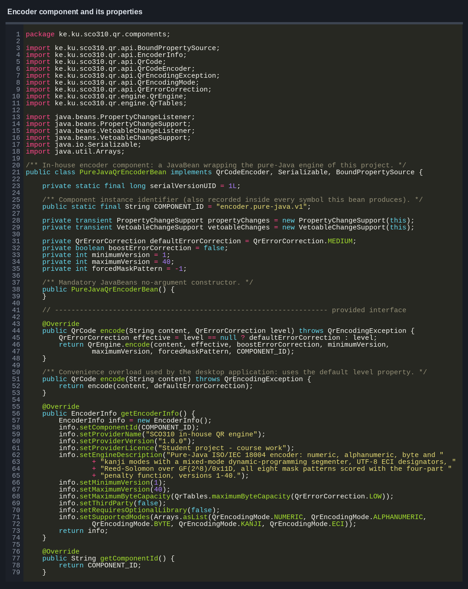

`PureJavaQrEncoderBean` stores the encoder settings and passes the work to the QR engine. Its main
properties include the default error-correction level, minimum version, maximum version and forced
mask.

### 3.3 Error correction

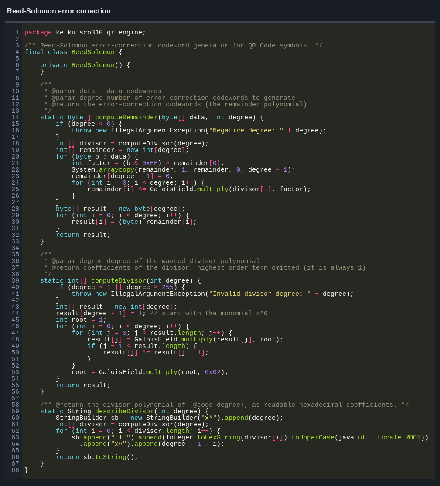

`ReedSolomon` creates the error-correction codewords. These codewords allow a damaged QR Code to
remain readable within the limit of its selected error-correction level.

### 3.4 PNG creation

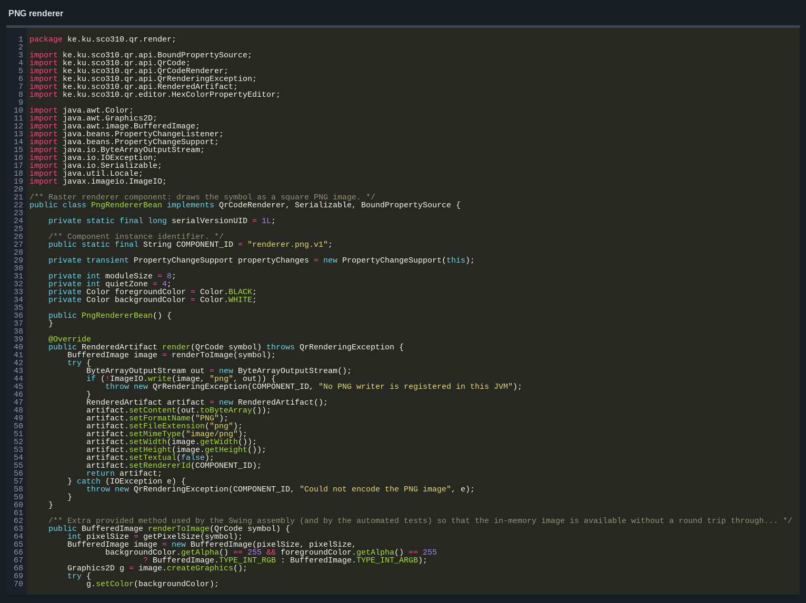

`PngRendererBean` creates the image, paints the background and draws every dark QR module. The final
image is returned as a `RenderedArtifact`.

### 3.5 Generation process

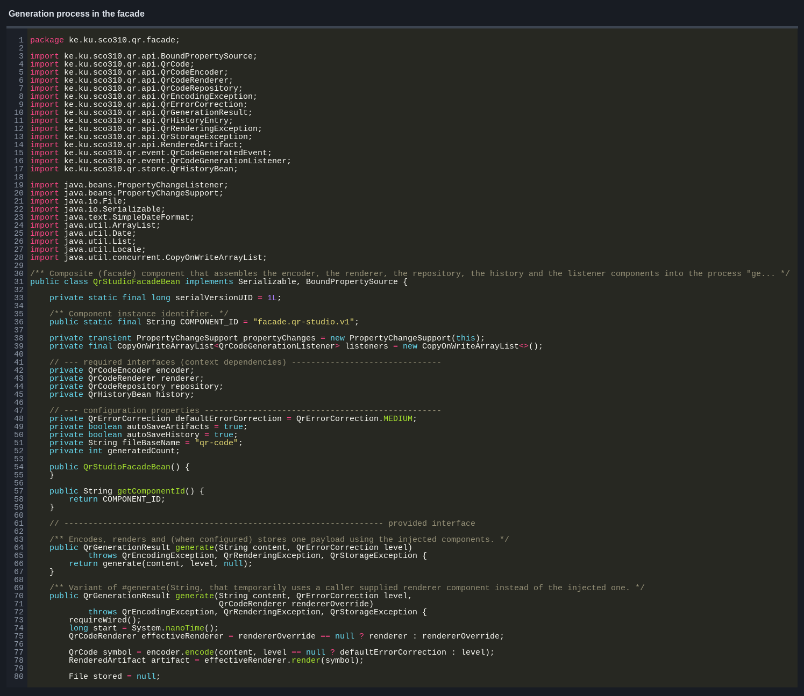

`QrStudioFacadeBean` controls the main process:

1. encode the text;
2. render the QR Code;
3. save the generated file;
4. update the history; and
5. notify registered listeners.

### 3.6 Loading and connecting components

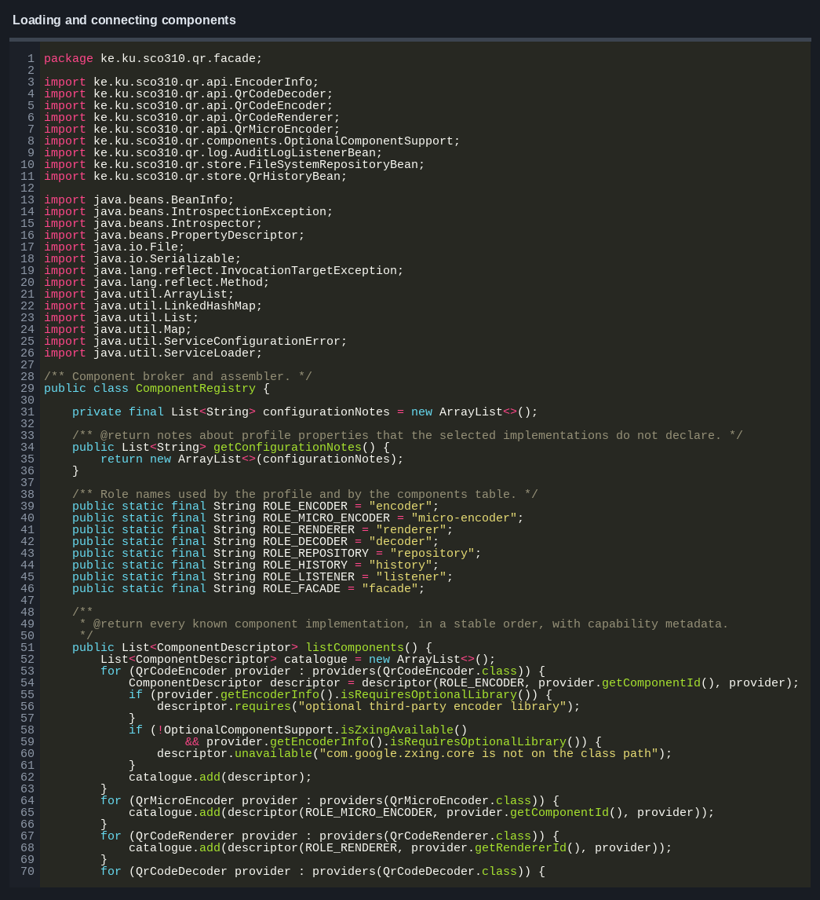

`ComponentRegistry` loads the selected components, applies their property values and checks that the
required connections are available.

### 3.7 History

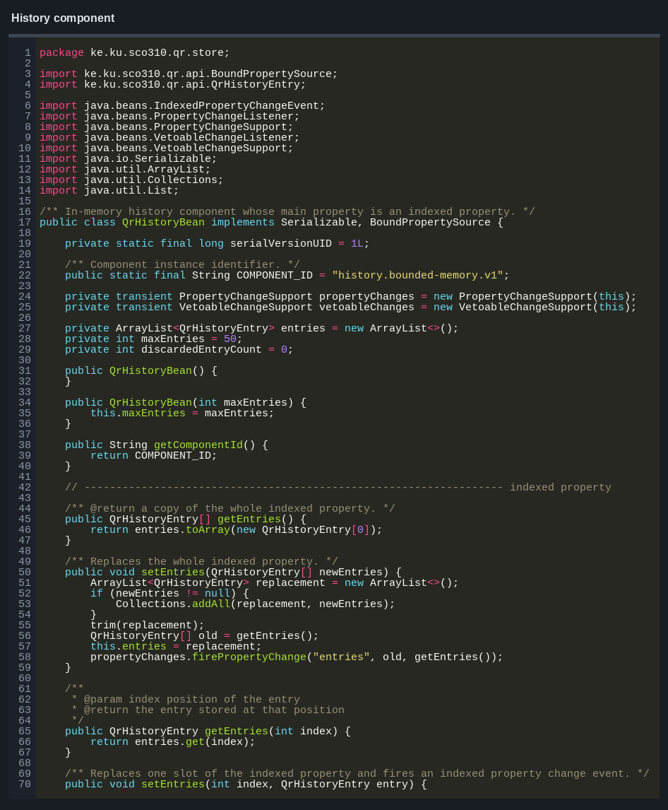

`QrHistoryBean` stores recent generation records. Its maximum size can be changed, and older entries
are removed when the limit is reached.

### 3.8 Desktop window

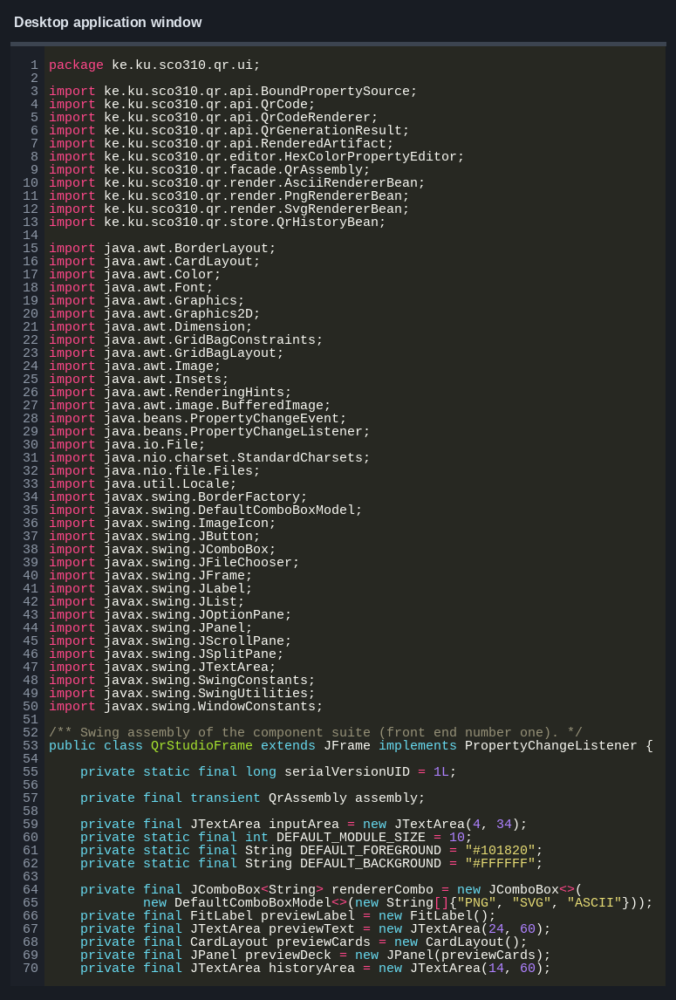

`QrStudioFrame` reads the user input, calls the facade and displays the returned result. The QR
encoding algorithm is kept outside the window class.

### 3.9 ZXing adapter

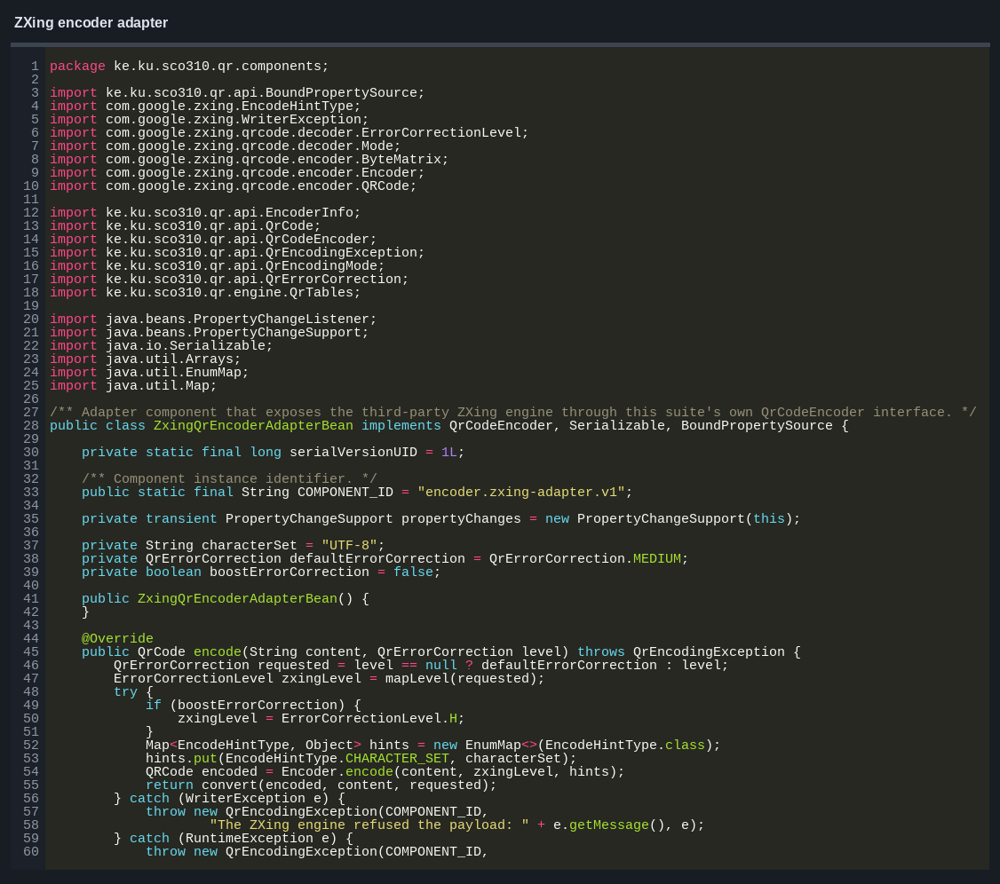

`ZxingQrEncoderAdapterBean` allows ZXing to be used through the same `QrCodeEncoder` interface. The
rest of the application does not need to know which encoder is connected.

---

## 4. Components used

| Role | Component | Main work |
|---|---|---|
| Encoder | `PureJavaQrEncoderBean` | creates standard QR Codes |
| Encoder | `ZxingQrEncoderAdapterBean` | uses the optional ZXing encoder |
| Micro QR encoder | `MicroQrEncoderBean` | creates Micro QR M1–M4 symbols |
| Decoder | `PureJavaQrDecoderBean` | reads supported QR matrices and generated files |
| Decoder | `ZxingQrDecoderAdapterBean` | uses ZXing for decoding |
| Renderer | `PngRendererBean` | creates PNG images |
| Renderer | `SvgRendererBean` | creates SVG files |
| Renderer | `AsciiRendererBean` | creates text output |
| Renderer | `RoundedModuleRendererBean` | creates rounded PNG images |
| Renderer | `PdfRendererBean` | creates PDF files |
| Repository | `FileSystemRepositoryBean` | saves files and stored history |
| History | `QrHistoryBean` | keeps recent generation records |
| Listener | `AuditLogListenerBean` | records generation events |
| Facade | `QrStudioFacadeBean` | controls the generation process |

### 4.1 JavaBeans features used

The components use public no-argument constructors and getter/setter methods. Bound properties send
change events when their values are updated. Constrained properties can reject invalid values.
`QrHistoryBean` also provides indexed access to individual history entries.

`PngRendererBeanBeanInfo` and `QrHistoryBeanBeanInfo` provide extra information about the bean
properties. `HexColorPropertyEditor` changes hexadecimal colour text into Java `Color` objects.

---

## 5. QR Code generation

The built-in encoder follows these steps:

1. check the text and choose suitable encoding modes;
2. choose the smallest version that can hold the data;
3. add the mode, character count, data and padding bits;
4. create Reed–Solomon error-correction codewords;
5. place the finder, timing, alignment and data modules;
6. test the eight mask patterns; and
7. add the format and version information.

Numeric, alphanumeric, byte, Kanji, UTF-8 ECI and mixed-mode content are supported. Standard QR
versions 1–40 and error-correction levels L, M, Q and H are available. Micro QR M1–M4 is handled by
a separate encoder component.

---

## 6. Configuration and saved data

`config/assembly.xml` stores the selected components and their property values. `AssemblyProfile`
loads this file, while `ComponentRegistry` creates and connects the components.

`FileSystemRepositoryBean` saves generated files in the configured folder. It also stores the
history so that previous records can be loaded again. `AssemblyGraphBean` supports saving and
restoring the connected bean objects through `XMLEncoder` and `XMLDecoder`.

---

## 7. Testing

The project includes checks for encoding, decoding, renderers, component properties, history,
configuration and saved files. The tests also use ZXing to decode generated symbols and compare the
result with the original text.

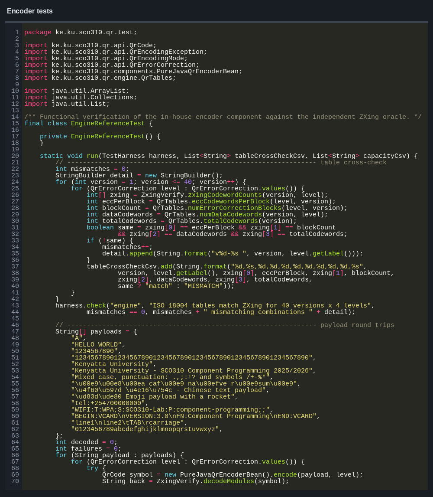

The latest full test run completed successfully. Invalid component names, missing connections and
corrupted files are also tested to make sure errors are detected.

---

## 8. Problems fixed

### 8.1 Error-correction blocks

The first multi-block version placed some data and error-correction codewords in the wrong order.
The interleaving step was corrected and checked with larger QR versions.

### 8.2 Large preview images

Large QR Codes could be cut off in the desktop window. The preview layout was changed so the result
can fit or scroll correctly.

### 8.3 History property

The history entries were first shown as a normal property. `IndexedPropertyDescriptor` was added so
individual entries can be discovered and accessed correctly.

### 8.4 Optional ZXing library

The application now checks whether ZXing is available before selecting its adapter. If it is not
available, the built-in encoder remains selected.

---

## 9. Conclusion

QR Component Studio generates QR Codes through separate encoder, renderer, storage, history and
listener components. These parts are connected through shared interfaces, which allows an encoder or
renderer to be changed without changing the rest of the application.

The desktop application generates PNG, SVG and text output, saves the result and records recent
operations. The built-in QR engine handles the complete generation process, while the optional ZXing
adapter provides another encoder using the same interface.

---

## 10. References

1. International Organization for Standardization and IEC. *ISO/IEC 18004:2015 — QR Code bar code
   symbology specification*.
2. Szyperski, C. *Component Software: Beyond Object-Oriented Programming*. Second edition,
   Addison-Wesley, 2002.
3. Oracle. *JavaBeans Specification* and `java.beans` API documentation.
4. ZXing Project. *ZXing Core 3.5.3*.
5. SCO 310 / SIT 300 Component Programming course materials, Kenyatta University.
